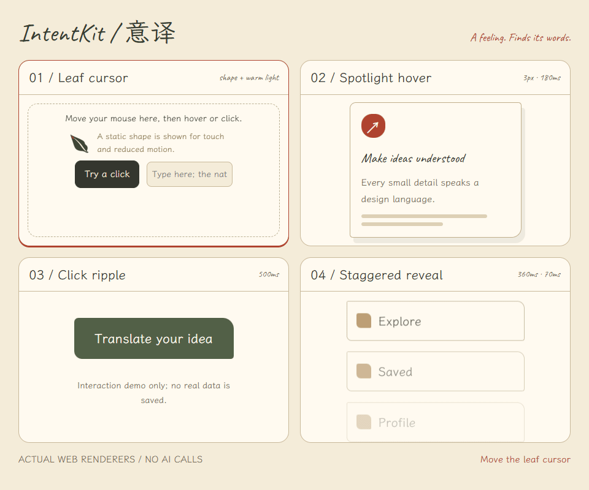
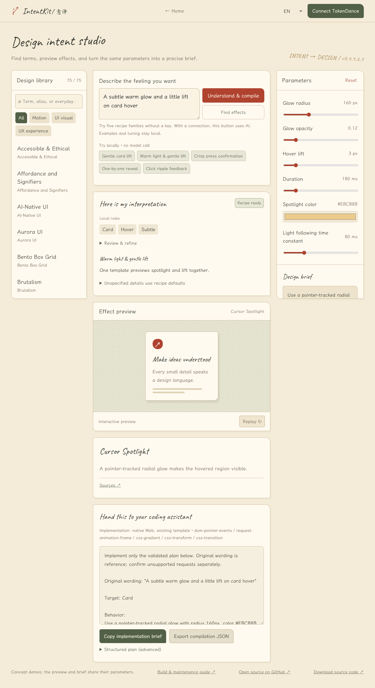

# IntentKit / 意译

[中文](README.md) · [English](README.en.md) · [日本語](README.ja.md) · [한국어](README.ko.md) · [Deutsch](README.de.md)

**把「我想要这种感觉」，变成看得见、调得动、交给编程助手就能说明白的设计方案。**

[打开官网](https://vibe-design-labs.github.io/Vibe-UI-UX/) · [直接试用工作台](https://vibe-design-labs.github.io/Vibe-UI-UX/studio.html) · [更新记录](CHANGELOG.md)

**v0.4.4.0.2 · 75 设计词条 · 75 专属预览模板 · 5 本地配方家族 · MIT + OFL**

[](https://vibe-design-labs.github.io/Vibe-UI-UX/studio.html?item=custom-cursor)

上图录制自项目现有渲染器，没有使用模型生成画面。GIF 只是演示录像；[在线工作台](https://vibe-design-labs.github.io/Vibe-UI-UX/studio.html)可以实际交互、调整参数，也会尊重系统的减少动态效果偏好。

## 让模型真正编写新效果

1. 连接 TokenDance，描述具体交互，点击 **让 AI 编写新效果**。模型生成完整 HTML / CSS / JavaScript，不再只选已有模板。
2. 在 **AI 原创效果** 区操作隔离预览、调整模型声明的参数、展开实际源码。运行失败会如实提示，未通过预览的代码不能申请收录。
3. 导出 **Web 源码 ZIP**，解压后运行 `python -m http.server 4180`；或保存 **效果 JSON**，稍后导入工作台恢复同一代码与参数。导出与调参不再次调用模型。
4. 点击 **申请收录 · 待审 PR**，确认公开代码和 MIT 许可，在 GitHub 确认投稿。机器人创建独立数据 PR，维护者核验后才收录和更新官网；不执行投稿代码、不自动合并。

本轮新代码生成支持原生 Web；五个既有模板的 React / 视频导出继续保留。失败状态区分未收到响应、输出截断、JSON 无效、校验失败与预览运行错误；不会自动付费重试。真实密钥付费联调尚未完成，代码质量仍需人工审核。详见[代码契约、诊断与投稿说明](docs/GENERATED_EFFECTS.md)。

生成前检查工作台的 **当前生效模型**：切换立即生效，本次请求只发送这个 ID，不配置备用模型。代码生成使用流式输出，分别显示推理和代码进度；Kimi K3（`kimi-k3`）使用 `high` 推理和 JSON 模式，单次输出上限 16,000 tokens。首次响应最多等待 150 秒，之后连续无数据 120 秒或总计 10 分钟则结束等待。生成模式隐藏词库模板，失败不会把旧模板当成生成结果。

展开 **调用模型核对** 查看请求 ID 与服务响应报告的模型 ID；不同则拒绝结果，缺失则标记无法核对。可复制不含密钥、提示词、源码和推理正文的诊断，对照 TokenDance 日志。服务报告的 ID 一致不等于独立证明了平台内部路由。[本次修复与验收边界](docs/RELEASE_0.4.4.0.2.md)。

## 这是做什么的？

Vibe coding 最难的一步常常是把感觉讲清楚：轻盈到底是抬升、缩放，还是更大的留白？IntentKit 把日常表达与中英文术语、别名、效果示例和具体参数连接起来，帮助设计师、开发者与刚开始使用 AI 编程的人对齐意思。

新版 Design Compiler 的流程是 **日常表达 → 可编辑的意图理解（Design IR）→ 受控配方 → 真实预览 → 设计描述 / Agent 描述 / JSON**。它是可以检查的设计方案工具，配方模式限定已有实现；新增的 AI 代码通道在隔离窗口运行模型编写的单个效果，不生成完整网站。

| 功能 | 当前可以做什么 |
| --- | --- |
| 设计词库 | 搜索 75 个词条的术语、别名与已整理的日常表达，查看释义、适用场景和来源 |
| 效果工作台 | 使用 75 个对应模板，调整注册参数，复制描述、导出 JSON、分享单效果参数链接 |
| Design Compiler | 5 类本地配方：轻微抬升、暖光与抬升、按压反馈、错落入场、点击水波 |
| 自定义鼠标 | 8 种指针形状，可调颜色、大小、跟随与点击反馈；聚光颜色、半径和透明度独立可调 |
| 多语言 | 中、英、日、韩、德界面；本文顶部的链接切换 README 文档语言 |
| 可选 AI | 使用自己的 TokenDance 连接解析设计意图或推荐已知候选效果 |

## 第一次使用：先不用密钥

1. 打开[工作台](https://vibe-design-labs.github.io/Vibe-UI-UX/studio.html)，在右上角选择界面语言。
2. 点击「本地试试」中的「轻轻浮起的卡片」，或输入 `卡片鼠标放上去轻轻浮起来，不要太夸张`，点击「理解并匹配配方」。没有配置密钥时走本地规则。
3. 查看「意图理解」，展开编辑项修正目标、触发方式与强弱偏好。默认值与推断会单独列出；需要补充的信息不会被装作已确认。
4. 鼠标移入卡片查看效果，再调右侧参数。预览、设计描述和方案使用同一组最终参数。若调整偏离原意，先查看冲突，再明确确认要采用当前参数。
5. 在编译结果区复制 **Agent 描述**，交给你使用的编程助手；或导出**方案 JSON**。右侧原有「导出 JSON」仍用于**单效果 JSON**，两者用途不同。

只想查词？使用左侧搜索框输入 `玻璃卡片`、`frosted glass` 或 `backdrop-filter`。从词条中查看释义、来源和描述。**每个官网词条都配有对应预览**：视觉风格展示独立材质与编排，动效展示真实运动，看板用明确标注的模拟数据，UX 原则用任务和状态演示。不再使用通用概念占位。详见[专属预览与维护要求](docs/PREVIEW_SCENES.md)。



## 把效果接入自己的项目

首批 **5 类效果支持独立 Web、React 组件 / hook、视频工程 ZIP**：暖金聚光与抬升、悬停抬升、按压反馈、点击波纹、错落入场。聚光采用真实 WebGL 灯光层，其他动效使用 DOM。

1. 在工作台选择上述效果，调参；如有 Compiler 冲突，先确认。
2. 在「组件代码」选择目标并下载，或打开独立示例对照参数与时间轴。
3. Web 包解压后运行 `node serve.mjs`，无需安装依赖。React 包接入自己的 React 18/19 项目；视频包运行 `npm install` 与 `npm run render`。
4. 永久改参数时编辑 `effect.json` 并运行 `node sync-export.mjs`，同步 JSON、描述与清单。其他 70 个词条不提供占位代码。

[完整接入和验证边界](docs/WEB_COMPONENTS.md)。代码导出不需要密钥；视频是 4 秒脚本演示。本轮版本先交待审 PR，人工合并并部署后官网更新。

## 想用 AI 时再连接 TokenDance

1. 点击右上角「连接 TokenDance」。连接面板会读取公开模型目录，这一步不调用模型。
2. 通过 TokenDance 授权弹窗创建密钥，或从 [TokenDance 密钥管理](https://tokendance.space/keys)取得自己的 Key 后手动填写。授权会在你确认后创建 Key。
3. 选择支持对话协议的模型，点击「仅保存到本页」。如果目录读取失败，可以手动填写官方模型 ID。
4. 只有配置密钥后主动点击「查找效果」、「理解并匹配配方」或「让 AI 编写新效果」才请求模型，费用由 TokenDance 收取。五个「本地试试」示例即使已经连接，也保持本地运行。
5. 用「清除密钥」断开连接。**密钥只在本页内存，刷新后清除**；没有账号系统，也不写 localStorage、sessionStorage、仓库或 GitHub Secrets。语言偏好可以保存。

GitHub Pages 版由浏览器直连 TokenDance，本地服务版经当前实例转发。只在可信部署中输入密钥。解析失败会回退本地规则，不自动重试付费请求；真实密钥的付费端到端联调尚未完成。详见[接入方式与验证边界](docs/TOKENDANCE.md)。

## Fork 后在自己电脑运行

需要 **Node.js 20+**；内容检查与源码打包另需 **Python 3**。项目没有 npm 依赖，无需先运行 npm install，也无需密钥启动。

```sh
git clone https://github.com/Vibe-Design-Labs/Vibe-UI-UX.git
cd Vibe-UI-UX
npm run dev
```

打开 [http://localhost:4173/studio.html](http://localhost:4173/studio.html)。使用 Fork 时，将 clone 地址换成自己的仓库地址。修改源码后停止并重新启动服务，让构建重新载入。

检查并复现纯静态部署：

```sh
npm test
npm run check:content
npm run check:docs
python scripts/package-source.py
npm run build:pages
npm run preview:pages
```

静态预览位于 [http://localhost:4174/Vibe-UI-UX/](http://localhost:4174/Vibe-UI-UX/)，输出目录是 `dist/pages/`。macOS/Linux 上如果没有 python 命令，使用 python3。本地构建、检查和打包不联网调用模型。

## 发布你自己的 GitHub Pages

1. Fork 本仓库，在自己的仓库启用 Actions。
2. 打开 **Settings → Pages → Source → GitHub Actions**。
3. 在 **Actions → Deploy GitHub Pages → Run workflow** 触发首次发布。
4. 工作流成功后从 Pages 设置或部署输出打开你的实际网址；此后推送 main 自动部署。

相对路径支持仓库子目录与 Fork，无需改原作者用户名。**不用设置模型密钥或 GitHub Secret**，访客自行连接自己的 TokenDance。完整[部署指南](docs/GITHUB_PAGES.md)。

## 更新词条、配方和效果

把 [维护 skill](skills/ui-ux-content-maintainer/SKILL.md)交给你选择的、能读写文件的 AI，也可以直接手动编辑。选择已有模板时，在 `content/items/` 增加一个 JSON；新增模板需要同时更新注册表和受控渲染器。扩充编译配方使用[配方维护说明](skills/ui-ux-content-maintainer/references/compiler-recipes.md)。

运行 `npm run check:content`、`npm test` 与 `npm run check:docs` 后，按需要重建[字体子集](docs/FONTS.md)、源码包和 Pages。维护脚本不需要 GPT Key，不消耗模型额度；你选用的其他 AI 可能有自己的服务费用。[完整维护流程](docs/CONTENT_MAINTENANCE.md)。

| 位置 | 作用 |
| --- | --- |
| `content/items/` | 词条、别名、语言正文、来源、审校状态 |
| `previews/registry.json` + `public/previews.js` | 受控参数契约与渲染器 |
| `compiler/` + `public/compiler-*.js` | IR、五语表达、配方、校验、编译界面 |
| `public/` | 静态官网、工作台、五语文案、TokenDance 连接 |
| `server/worker.js` | 可选本地/Worker 中转；GitHub Pages 不依赖它 |
| `.github/workflows/pages.yml` | 检查、源码打包、构建和部署 |

## 工作台直接投稿

五类已支持效果可以直接点击 **「提交收录 PR」**。填写名称、用途、可选署名与来源，确认公开许可后，在 GitHub 点击 Submit new issue；仓库自动创建携带案例 JSON 的待审 PR，并回复链接。用户无需手动 Fork、安装工具或填写 GitHub Token。

你审核并手动合并后，案例进入[社区页](https://vibe-design-labs.github.io/Vibe-UI-UX/community.html)，可实际预览、调参和导出。投稿不会写入 main 或自动部署。[用户与维护者操作说明](docs/COMMUNITY_PR.md)。本轮工作流进入 main 并启用 Actions 创建 PR 权限后，自动投稿才会生效。

## 社区贡献与署名

已有参数案例采用 **工作台制作 → GitHub 确认 → 自动创建待审 PR → 维护者审核 → 手动收录**。新代码通过普通 Fork / PR 投稿，私信讨论可选。贡献者可以为自己的案例署名；测试通过不等于同意合并。一般不含私人资料的 bug 可以直接提 Issue。

[给贡献者的指南](docs/CONTRIBUTING.md) · [给 AI 的指南](docs/CONTRIBUTING_AI.md) · [案例提交表](docs/contributions/TEMPLATE.md) · [署名记录](docs/contributions/README.md)。插件、多端与可复用代码的[后续方案](docs/COMMUNITY_ROADMAP.md)是规划，尚未作为功能上线。

## 当前边界

- 词条正文主要是中英文草稿；日、韩、德正文明确回退英文。五语界面不等于五语知识内容已经审校完成。
- 本地规则覆盖 5 个配方家族，不是通用设计理解。模糊、冲突或不支持的输入会列出待确认项；当前不支持跨模板组合、弹簧或从句子自动映射精确数值。
- 内容结构检查通过不等于来源、事实与翻译已经人工核准。严格发布审校检查目前应失败，草稿状态保留；未能读到的微信正文没有被编造为已读来源。
- 预览是交互概念示例，不会真实保存数据；导出需由你与开发者审阅后实现。系统减少动态效果、触摸与键盘保留适合的交互。

[编译器结构与约束](docs/DESIGN_COMPILER.md) · [50 个新词条与来源状态](docs/CONTENT_EXPANSION_2026-10-07.md) · [本次发布检查](docs/RELEASE_0.4.4.0.1.md) · [五段版本规则](docs/VERSIONING.md)

## 许可与致谢

应用代码为 [MIT](LICENSE)。字体 Ma Shan Zheng、LXGW WenKai 与 Caveat 使用 **SIL OFL 1.1**，完整许可与子集重建步骤见[字体说明](docs/FONTS.md)。README 的截图和 GIF 来自本项目实际界面。

早期交互方向参考 Hyperknow；米纸、水墨、朱砂与手写气质来自用户给出的视觉参考。编排和代码为原创，未使用参考网站的图片、商标或组件源码。欢迎按[贡献指南](docs/CONTRIBUTING.md)提供准确的来源、译文与可验证案例；一般问题反馈可提 [Issue](https://github.com/Vibe-Design-Labs/Vibe-UI-UX/issues)。
