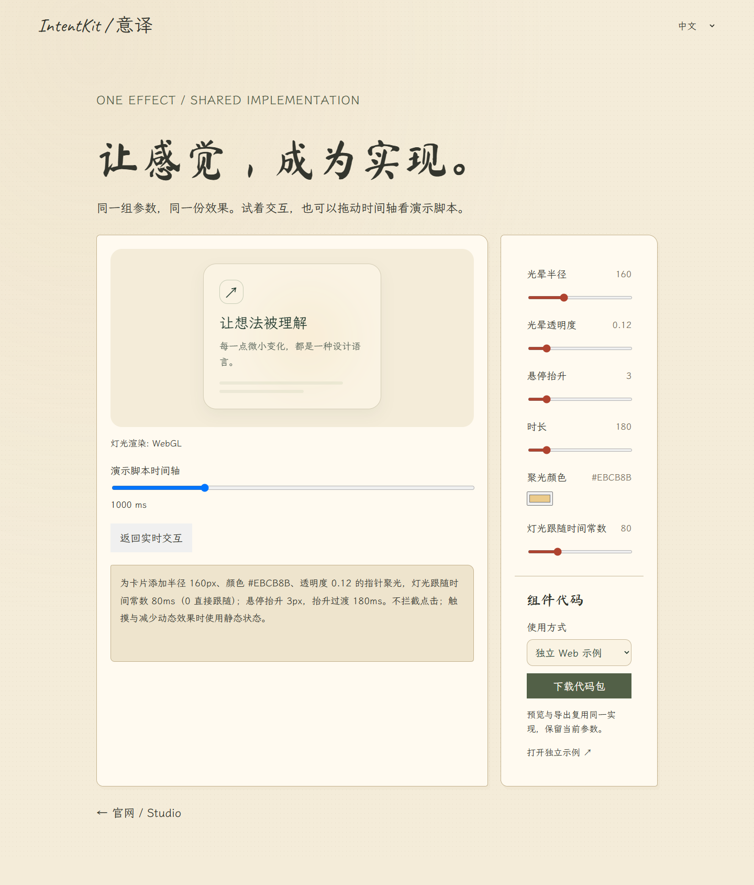

# 0.4.2.0.0 验证与交付记录

日期：2026-10-13。本轮通过开发分支与待审 PR 交付，不自动合并 main。官网仍为上一发布版本，待维护者人工合并并完成 Pages 部署后更新。

## 实现范围

- 首个完整试点：暖金 WebGL 聚光 + 轻微抬升，米纸 / 墨绿 / 朱砂的品牌演示。
- 5 个受控模板提供原生 Web、React 组件 / hook、Remotion 工程导出。其余 70 个词条继续有专属预览，但不输出虚假占位组件。
- 共享参数契约、渲染模块和确定帧算法；导出包以 effect.json 为运行时源，保留同参 JSON、描述、清单与可选编译快照。
- 人类 / AI 双版本贡献指南、署名模板、私信提案、只读 PR CI 与 main 分支保护；维护者人工审核。新署名索引没有虚构投稿。

## 实际验证

| 检查 | 结果与范围 |
| --- | --- |
| 自动测试 | 50 / 50，通过契约、拒绝无实现 / 越界、乱序帧、ZIP CRC、五语等检查 |
| 实际浏览器下载 | 5 效果 × 3 格式，共 15 个 ZIP；与对应工作台单效果 JSON 和描述逐一匹配；Python zipfile 独立验证 CRC |
| React 实跑 | React 19.3.0、StrictMode；5 种默认演示与 5 种自定义 hook 目标，参数更新、反复挂载、5 项列表、键盘按压 / 波纹及减少动态效果 |
| 原生 / React / 官网比较 | 暖金试点同一组参数、同一字体；卡片 340 px、内边距 30 px、图标 46 px、文字样式和抬升 3 px 一致 |
| 视频实跑 | Remotion 4.0.534，ANGLE；暖金试点实际渲染 720 × 720、30 fps、120 帧 MP4；按 30 → 0 → 75 → 30 的顺序输出，重复第 30 帧逐像素相同 |
| 参数永久修改 | sync-export 合法参数同步 JSON / 描述 / 清单；越界值和编译快照冲突在写入前拒绝 |
| 生命周期与回退 | WebGL 上下文丢失 / 恢复、CSS 回退标记、按压窗口失焦恢复、卸载恢复原样式 |
| Compiler 联动 | 未确认意图冲突禁止导出；确认后允许，下一次变更重新要求确认 |
| 响应式 / 五语 | 独立示例在 360 / 820 / 1440 px × 中英日韩德，共 15 个布局，无横向溢出 |
| 密钥与模型 | 上述本地检查没有模型调用，不使用真实密钥 |



实际生成的 [4 秒试点视频](media/component-spotlight.mp4)来自导出工程。它是固定脚本演示，不是鼠标操作录像。

## 复现入口

```sh
npm test
npm run check:content
npm run check:docs
python scripts/package-source.py
npm run build:pages
npm run preview:pages
```

本地浏览 `http://localhost:4174/Vibe-UI-UX/effect-example.html?item=cursor-spotlight`，按 [组件导出说明](WEB_COMPONENTS.md)下载并运行工程。浏览器检查用 Windows Chrome + ANGLE 软件 WebGL；不是所有操作系统 / 浏览器的兼容认证，也不是硬件性能测量。

本轮真实 MP4 渲染覆盖聚光试点；其余 4 个视频包已经生成并核对数据与共享 React 实现，尚未分别输出 MP4。不宣称全部视频都完成最终平台验证。React 18 是 peer 范围，实际运行验证用 React 19.3.0。词条来源 / 翻译仍保留原草稿状态，未进行真实付费 TokenDance 联调。

## 审核与后续

main 禁止强推和删除，要求 PR 审批、code owner review、更新后重新审批、对话解决与线性历史；管理员保护已开启，仅 virtue192 保留明确人工发布例外。CODEOWNERS 随首个 PR 合并后生效。新 PR 工作流只读、无模型密钥且不部署，真实检查成功后绑定为必需状态检查。

这次不实现插件、移动 App、账号同步或 REA 接入；后续优先完善 Web 效果的业务复用与验证。
