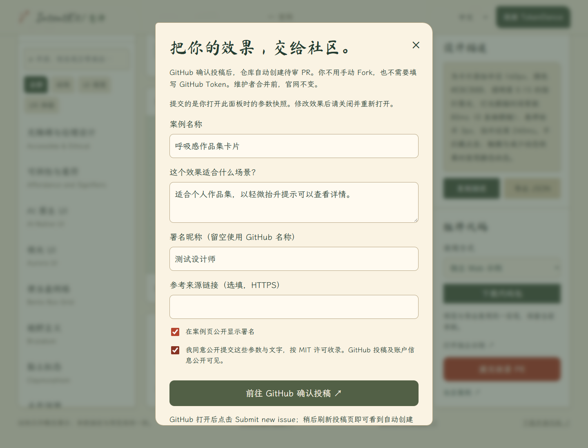
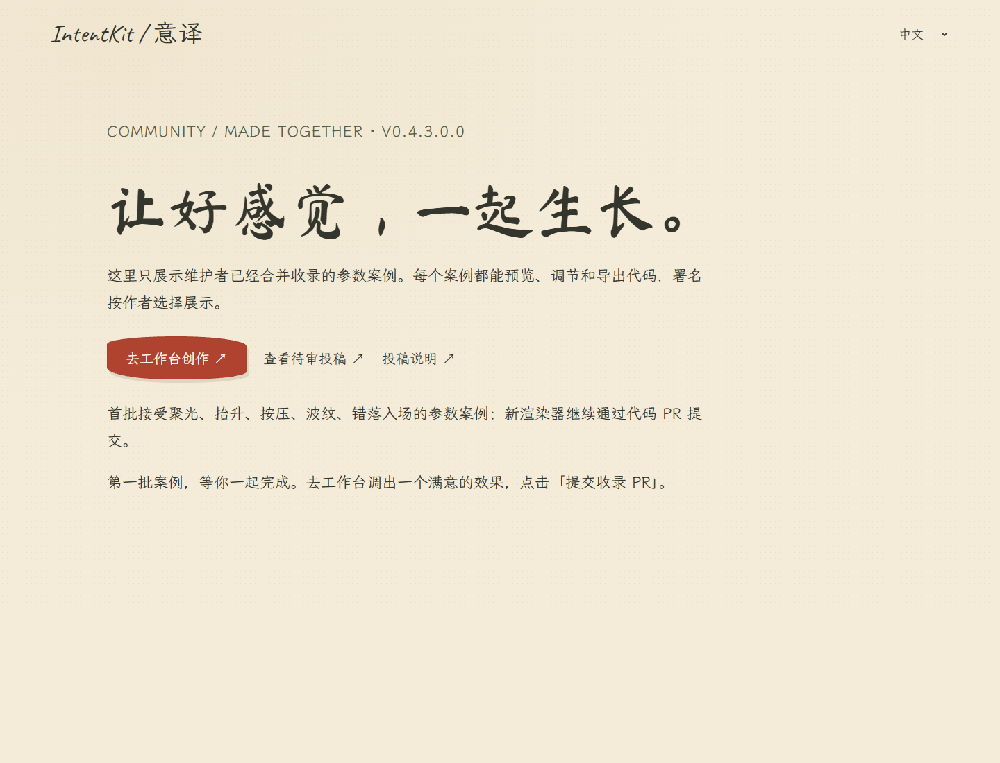

# 0.4.3.0.0：社区待审 PR 验证记录

2026-10-13。本轮新增工作台参数案例直投、GitHub 自动待审 PR、署名与社区案例页。只有更新 PR 合并到 main、创建 PR 权限配置成功并完成 Pages 部署后，投稿自动化才会上线。

## 已完成检查

| 验证 | 实际结果 |
| --- | --- |
| 自动测试 | 57 / 57，包括五模板数据、许可与身份、参数拒绝、独立分支、重复 / 修改投稿、关闭撤回、固定 API 与敏感错误处理 |
| 内容结构 | 75 词条、0 errors；375 条原有草稿 / 缺少正文译文警告保留 |
| 维护 skill | quick_validate 通过 |
| 浏览器投稿 | 表单数据与原始参数匹配；确认链接指向正确 GitHub 仓库；未确认 Compiler 冲突禁止投稿；无实现模板禁用 |
| 五语布局 | 360 / 820 / 1440 px × 中英日韩德，共 15 组投稿面板 / 社区页布局，无横向溢出 |
| 真实 UI / 生命周期 | 面板关闭恢复焦点；社区每页 6 个实例，8 条本地测试数据翻页后为 2 个，同参数链接正确；页面返回恢复预览 |
| 首页入口 | 三种视口检查社区导航，无横向溢出或页面异常 |
| GitHub API 实测 | [测试 PR #5](https://github.com/Vibe-Design-Labs/Vibe-UI-UX/pull/5)：只有 community/cases/case-4.json，身份取真实 GitHub 作者，重复处理保持同一 PR；main 前后 commit 相同 |
| 测试清理 | 测试 PR / 接收 Issue 已关闭，临时投稿分支已移除；没有合并，没有创建虚构的已收录社区案例 |
| 模型请求 | 上述本地检查没有模型调用，无需 TokenDance Key |

## 验证边界

GitHub API 实测使用维护者本机已有认证，在内存中调用相同整理程序；它验证了 REST 分支 / 文件 / PR 接口与幂等，不等于已经验证 Actions 机器人的令牌权限。完整机器人链路必须在工作流进入默认分支并启用权限后再实测。浏览器表单测试验证预填 URL，未代替用户在 GitHub 点击提交。

画面与布局用 Windows Chrome + ANGLE 软件 WebGL。8 条社区测试数据只在本地浏览器拦截中使用，不写入仓库或官网。没有新的外部社区贡献可据此计数。

首批投稿只覆盖五种模板的参数案例，不执行模型生成代码、不自动导入新渲染器。GitHub 身份、帖子和 PR 是公开的；隐藏展示署名不能承诺匿名。

## 发布步骤

1. 人工审阅并合并本轮代码 PR。
2. 配置 Actions 的创建 PR 权限，保持 main 审核与必需 CI、CODEOWNERS、禁止强推 / 删除和自动合并关闭。
3. 等待 Deploy GitHub Pages 成功，核对线上版本和投稿 / 社区页。
4. 创建一条明确标为测试的真实投稿，确认机器人 PR 文件、参数、作者、检查与 main 未变，再关闭测试投稿撤回 PR；不把测试案例合并到官网。
5. 将 [公众投稿说明](COMMUNITY_PR.md)提供给第一批真实参与者。

源码打包、Pages 构建、五语 README 链接校验和 GitHub CI 结果随本轮 PR 提供。
